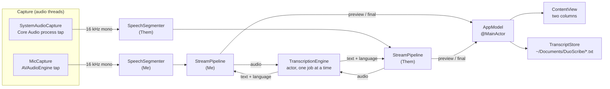

# Architecture

## Data flow



1. Each capture class converts its audio to 16 kHz mono floats with `MonoResampler` and hands it to its own
   `SpeechSegmenter`.
2. The segmenter cuts the stream into utterances at pauses and keeps the utterance in progress available for
   previews.
3. Each `StreamPipeline` polls its segmenter. Finished utterances are transcribed and reported as final lines;
   while someone is talking it transcribes the growing utterance about once per second as a preview.
4. Both pipelines share one `TranscriptionEngine`, which runs one Whisper request at a time.
5. `AppModel` collects final lines, applies the echo filter, publishes state to the UI, and rewrites the
   transcript file after every change.

## Threading

| Where | What runs there |
| --- | --- |
| Audio threads (AVAudioEngine tap, Core Audio IO queue `duoscribe.system-audio`) | Capture callbacks, resampling, `SpeechSegmenter.append` |
| Main actor | `AppModel`, `StreamPipeline` loops, UI, capture start/stop, Core Audio listeners |
| `TranscriptionEngine` actor + detached tasks | Model download and load, Whisper inference |

`SpeechSegmenter` is the only object shared between an audio thread and the main actor; it uses an `NSLock`
and hands out copies.

`TranscriptionEngine.transcribe` chains each request onto the previous one (`lastJob`), because actor
re-entrancy alone would let two inference calls overlap while one is suspended.

## Components

### MicCapture
Taps the default input device with `AVAudioEngine` (buffer 4096 frames, native format), takes the first channel
and resamples. Restarts itself on `AVAudioEngineConfigurationChange` (headset plugged in, AirPods connected).

### SystemAudioCapture
Captures everything the Mac plays, regardless of output device, using the Core Audio tap API (macOS 14.2+):

1. `CATapDescription(monoGlobalTapButExcludeProcesses: [])`: a private, unmuted tap of all processes, mixed to mono.
2. A private aggregate device whose tap list contains that tap. A tap can only be read through an aggregate device.
3. An IO proc on the aggregate device reads the input buffers; the tap's stream is taken from the **last** buffer
   (any real device streams come first), downmixed and resampled.

Two modes:
- `tapOnly` (tried first): the aggregate contains only the tap. This avoids opening the output device's input
  side, which for Bluetooth headsets would switch them to low-quality call mode.
- `withOutputDevice` (fallback): the default output device is added as main sub-device to clock the aggregate.
  A watchdog switches to this mode if no IO callbacks arrive within 2 seconds.

A listener on `kAudioHardwarePropertyDefaultOutputDevice` rebuilds the tap 0.5 s after the output device changes.

### SpeechSegmenter
Energy-based voice activity detection on 20 ms frames:
- A frame is voiced when its RMS exceeds `max(minimumLevel, noiseFloor × 3)`.
- The noise floor follows unvoiced frames (exponential average) and creeps up slowly during voiced frames, so
  a new steady noise stops counting as speech after a while.
- An utterance starts on the first voiced frame and includes 0.3 s of audio from before it.
- It ends after a pause (0.7 s, or 0.3 s once the utterance is longer than 12 s) or at 24 s (Whisper's window is 30 s).
- Utterances with less than 0.25 s of voiced audio are dropped; 0.2 s of trailing pause is kept.

### StreamPipeline
Loop per stream, polling every 150 ms:
- A finished utterance always goes first: transcribe, clear the preview, emit a final line.
- Otherwise, if the utterance in progress is at least 1 s long and has grown by 1 s since the last preview,
  transcribe it and show the result as a preview (discarded if the utterance ended in the meantime).
- On stop, `finish()` flushes the segmenter and drains the remaining utterances before the loop ends.
- Remembers the last language detected on this stream (`nl` or `en`, initially `nl`) as the fallback language.

### TranscriptionEngine
- Model: `openai_whisper-large-v3-v20240930_626MB` (Whisper large-v3-turbo, compressed) from
  `argmaxinc/whisperkit-coreml` on Hugging Face.
- Stored in `~/Library/Application Support/DuoScribe` (model and tokenizer). The model folder path is saved in
  `UserDefaults` (`modelFolder.<model name>`) only after a complete download, so later launches work offline.
- First load triggers Core ML specialization for the Neural Engine, which takes minutes once per OS version.
- Decoding: greedy (temperature 0, two fallbacks), no timestamps, `windowClipTime: 0` (the default 1 s clip would
  drop clips shorter than 1 s), clips shorter than 1 s are padded with silence.
- Language: `Auto NL/EN` lets Whisper detect the language; if it detects anything other than `nl` or `en`, the
  clip is decoded again with the stream's fallback language. `Nederlands` / `English` force the language.
- Output goes through `TextTools.clean`, which removes bracketed non-speech tags and known subtitle-credit
  hallucinations ("Ondertitels ingediend door de Amara.org gemeenschap" and similar).

### AppModel
- Owns the captures, pipelines and engine; starts loading the model when the window appears.
- Start: asks for microphone access, creates a new transcript file name, starts both captures (continues with
  one if the other fails), starts the pipelines and a 10 Hz level-meter timer.
- Stop: stops capture, drains both pipelines, saves.
- **Echo filter** (toggle, on by default): a Me line is dropped when at least 60% of its words (counted as a
  multiset, minimum 2 words) appear in the Them lines that overlap it in time (±3 s). Checked when a Me line
  arrives and again for the last 30 s of Me lines whenever a Them line arrives, because either side may finish
  transcribing first.

### TranscriptStore
`~/Documents/DuoScribe/Transcript yyyy-MM-dd HH.mm.ss.txt`, one file per Start. Rewritten atomically after every
change, lines sorted by start time:

```
Transcript, Wednesday 7 October 2026, 12:30

[12:30:05] Me: Hallo, hoor je mij?
[12:30:09] Them: Ja, ik hoor je goed.
```

## Tuning

| Setting | Value | Where |
| --- | --- | --- |
| Minimum speech level, Me / Them (RMS) | 0.004 / 0.002 | `AppModel.start` |
| Pause that ends an utterance | 0.7 s | `SpeechSegmenter.Settings.endSilence` |
| Shorter pause after `relaxAfter` | 0.3 s after 12 s | `relaxedEndSilence`, `relaxAfter` |
| Maximum utterance length | 24 s | `maximumLength` |
| Pre-roll | 0.3 s | `preRoll` |
| Minimum voiced audio | 0.25 s | `minimumSpeech` |
| Noise floor factor | 3× | `SpeechSegmenter.process` |
| Preview interval | every 1 s of new speech | `StreamPipeline.run` |
| Echo filter | ≥ 60% word overlap, ≥ 2 words, ±3 s | `TextTools.isEcho`, `AppModel.isEcho` |
| Whisper model | large-v3-turbo, 626 MB | `TranscriptionEngine.modelName` |
| System audio watchdog | 2 s | `SystemAudioCapture.scheduleWatchdog` |

## Decisions

| Decision | Why | Alternative considered |
| --- | --- | --- |
| WhisperKit (Whisper on Core ML) | Strong Dutch and English, language detection per clip, fully local, fast on Apple Silicon | Apple `SpeechTranscriber` (macOS 26+): less code, but one fixed locale per transcriber and Dutch support unconfirmed |
| Core Audio process tap | Native since macOS 14.2, no virtual audio driver to install, works for speakers and headphones | ScreenCaptureKit audio; BlackHole-style loopback driver |
| Two separate streams | Free Me/Them labels; the mic does not re-transcribe the speaker mix | Mixing both into one stream |
| Own energy VAD instead of WhisperKit's streaming helpers | Small, predictable, works the same for both streams and keeps the WhisperKit API surface small | `AudioStreamTranscriber`, `EnergyVAD` from WhisperKit |
| Text-based echo filter | Pure logic, no audio-unit configuration to get wrong | Voice processing (`setVoiceProcessingEnabled`) for acoustic echo cancellation; ducks other audio and changes the input format |
| Plain text transcript, rewritten on each change | Simple, crash-safe, easy to post-process | Append-only log, Markdown, JSON |
| SwiftPM + `build.sh` instead of an Xcode project | Reviewable text files only, easy for agents to edit | `.xcodeproj` |
